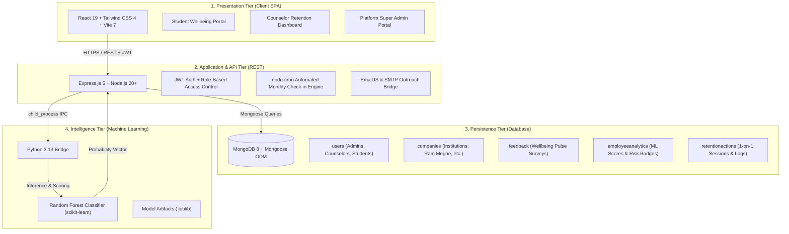

# DropGuard: Student Dropout Prediction & Academic Retention System

> **A Machine Learning-Driven Multi-Tenant Higher Education Retention & Early Intervention Platform**

---

## 🎓 Academic Attribution & Project Details

- **Candidate / Developer**: Kartik Nilesh Raghuwanshi
- **Project Guide / Supervisor**: Dr. Kalyani Hemant Deshmukh
- **Department**: Department of Computer Science & Engineering
- **Institution**: Prof. Ram Meghe Institute of Technology and Research (PRMITR), Badnera – Amravati
- **Academic Year**: 2025–2026
- **Research Publication**: *Multi-Tenant Framework for Early Student Attrition and Dropout Prediction Using Hybrid Machine Learning Models* (IJSREM, 10 Pages)

---

## 📌 1. Project Overview & Problem Scope

Student attrition and early college dropouts present severe institutional, financial, and societal challenges in higher education globally. Traditional retention methods suffer from:
1. **Infrequent Assessment**: End-of-semester or annual surveys detect disengagement long after students have already decided to withdraw.
2. **Disconnected Institutional Silos**: Academic grades, attendance metrics, and mental wellbeing indicators are stored in fragmented spreadsheets without unified visibility.
3. **Reactive Interventions**: Counselors and academic advisors typically intervene only when dismissal proceedings begin or exam hall tickets are denied.

**DropGuard** addresses these structural bottlenecks by delivering an end-to-end, multi-tenant academic retention platform that:
- Periodically tracks student wellbeing across four core academic engagement dimensions.
- Applies an ensemble **Random Forest Classifier** (`scikit-learn`) alongside heuristic survey scoring to identify high-risk dropout trajectories before exams.
- Empowers academic counselors with a dedicated **Retention Action Center** to launch proactive 1-on-1 counseling interventions, send automated email invitations, and track progress until academic stability is achieved.

---

## 🏗️ 2. System Architecture

The project implements a decoupled 4-tier architecture ensuring strict multi-tenant data isolation and scalability:



---

## 🚀 3. Key Modules & Functional Capabilities

### A. Multi-Tenant Institution Isolation
- Colleges, universities, and polytechnics register their workspace with an isolated `companyCode` / `institutionCode` (e.g., **Ram meghe** `QSDPT5`).
- Counselors can only inspect and manage students enrolled under their authorized institutional domain.
- Platform Super Admin manages global institutional onboarding, approvals, and system-wide analytics.

### B. Student Wellbeing Survey Engine
Students submit monthly or term-based pulse evaluations across four key academic dimensions evaluated on calibrated scales:
1. **Academic Engagement**: Course comprehension, curriculum pace, and attendance consistency.
2. **Faculty & Support Satisfaction**: Mentorship responsiveness, laboratory facilities, and advising availability.
3. **Stress & Workload Management**: Exam burden, personal challenges, and work-life-study balance.
4. **Sense of Belonging**: Campus community connection, peer collaboration, and institutional integration.

### C. Machine Learning Dropout Prediction Engine
- Utilizes an ensemble **Random Forest Classifier** trained on academic, demographic, and sentiment indicator features.
- Computes calibrated dropout probability vectors alongside survey averages.
- Categorizes students into discrete operational risk tiers:
  - 🟢 **Stable / Low Risk**: Positive engagement; standard academic track.
  - 🟡 **Moderate / Medium Risk**: Emerging stress or declining faculty connection; queued for automated reminder.
  - 🔴 **High / Critical Risk**: Imminent dropout indicators; prioritizes student at the top of the Counselor Retention Queue.

### D. Counselor Retention Action Center
- Real-time directory with search, course filters, and risk badges.
- One-click scheduling for confidential 1-on-1 academic counseling sessions.
- Direct outreach logging (WhatsApp, Email, In-person meeting records).
- Automated follow-up calendar with status monitoring (`Scheduled`, `Completed`, `Dismissed`).

### E. Automated Check-in & Survey Reminder Scheduling
- Background cron scheduler (`node-cron`) automatically triggers on the **1st of every month** at 09:00 AM to dispatch new survey invitations.
- Second automated follow-up triggers on the **8th of every month** specifically targeting students with pending submissions.

---

## 💻 4. Technology Stack

| Layer | Technologies & Libraries |
| :--- | :--- |
| **Frontend Framework** | React 19.2, Vite 7, React Router 7 |
| **Styling & UI Components** | Tailwind CSS 4, Lucide React (Icons), Custom Responsive Layouts |
| **Backend Framework** | Node.js 20+, Express.js 5.2 (ES Modules) |
| **Authentication & Security** | JSON Web Tokens (`jsonwebtoken`), `bcryptjs` password hashing, Cookie Parser, CORS |
| **Database & ODM** | MongoDB 8.x, Mongoose 9.9 |
| **Scheduling & Notifications** | `node-cron`, `@emailjs/browser`, `nodemailer` |
| **Machine Learning** | Python 3.13, `scikit-learn` 1.6+, `pandas`, `numpy`, `joblib` |
| **Model Architecture** | Random Forest Classifier, Decision Tree Ensembles |

---

## 🗄️ 5. Database Schema & Data Models

- **`User`**: Core identity table storing roles (`platformAdmin`, `hr` [Counselor], `student`), institutional affiliation, hashed password, student codes (`STU-XXXXXX`), course, and year of study.
- **`company`**: Multi-tenant institutional workspace record with status (`approved`, `pending`, `rejected`), institution code, primary counselor reference, and registration metadata.
- **`EmployeeFeedback` (Feedback)**: Student term survey records storing Likert scores, written counselor feedback, and academic cycle identifiers (`feedbackPeriod`).
- **`EmployeeAnalytics`**: Aggregated ML inference results, dropout probability percentages, experimental survey risk classifications, and rolling satisfaction averages.
- **`RetentionAction`**: Intervention tracking record storing scheduled counseling meetings, intervention logs, contact channel, and counselor notes.
- **`ModelMetadata`**: Versioning, feature importances, evaluation accuracy, and training audit trails for the active ML model.

---

## 🔑 6. Pre-Seeded Accounts & Test Credentials

All accounts in the database have been initialized with the universal password **`1234`** for testing and presentation:

### Platform Administration
| Role | Email | Password | Scope |
| :--- | :--- | :--- | :--- |
| **Platform Super Admin** | `admin@platform.com` | `1234` | Global System Access |

### Academic Counselors & Advisors (**Ram meghe** — Code: `QSDPT5`)
| Role | Name | Email | Password |
| :--- | :--- | :--- | :--- |
| **Lead Counselor** | Kartik Raghuwanshi | `raghuwanshikartik881@gmail.com` | `1234` |
| **Academic Advisor** | Kartik N. Raghuwanshi | `kartikraghuwanshi774@gmail.com` | `1234` |
| **Demo Advisor** | Dr. Kalyani Deshmukh | `counselor@demo.com` | `1234` |

### Enrolled Students (**Ram meghe** — Code: `QSDPT5`)
| Student Name | Email | Password | Student ID | Department & Year |
| :--- | :--- | :--- | :--- | :--- |
| **Kartik Raghuwanshi** | `raghuwanshikartik521@gmail.com` | `1234` | `STU-RM521` | B.Tech CSE (3rd Year) |
| **Aarav Deshmukh** | `student1@rammeghe.edu` | `1234` | `STU-RM001` | B.Tech IT (2nd Year) |
| **Pooja Sharma** | `student2@rammeghe.edu` | `1234` | `STU-RM002` | B.Tech AI & DS (1st Year) |
| **Rohan Patel** | `student3@rammeghe.edu` | `1234` | `STU-RM003` | B.Tech Mechanical (4th Year) |
| **Demo Student** | `student@demo.com` | `1234` | `STU-RM004` | B.Tech CSE (2nd Year) |

> 💡 **Quick Login**: The sign-in page (`/login`) includes 1-click **Quick Demo Sign-in** pill buttons for Admin, Counselor, and Student.

---

## 🛠️ 7. Installation & Local Setup Guide

### Prerequisites
- **Node.js**: v18.0.0 or higher
- **MongoDB**: Local MongoDB instance running on `localhost:27017` or MongoDB Atlas URI
- **Python**: v3.10 to v3.13 (with `scikit-learn`, `pandas`, `joblib` installed)

### Step 1: Clone or Navigate to Project
```bash
cd d:\StudentDropout\studentDropout
```

### Step 2: Backend Configuration & Start
```bash
cd Backend

# Install dependencies
npm install

# (Optional) Run database seeder to initialize default accounts and 'Ram meghe' workspace
node seedAdmin.js

# Start backend server (Port 5000)
node app.js
```

### Step 3: Frontend Configuration & Start
Open a separate terminal window:
```bash
cd d:\StudentDropout\studentDropout

# Install dependencies
npm install

# Start Vite development server
npm run dev
```

The application will be accessible at:
- **Frontend SPA**: `http://localhost:5173`
- **Backend API**: `http://localhost:5000`

---

## 📡 8. Core API Endpoints

### Authentication & Sessions
- `POST /login` — Authenticate user and issue JWT token (validates institution approval).
- `GET /api/auth/me` — Verify active token and retrieve database user profile.
- `GET /auth/verify` — Health verification endpoint for client interceptors.

### Counselor & Enrollment Operations
- `GET /hr/employees` — Fetch all enrolled students under counselor's institution with live ML risk indicators.
- `POST /Save` — Enroll a new student, generate unique `STU-` identifier, and assign advisor.
- `POST /hr/create` — Register a co-counselor or academic advisor under the active institution.
- `POST /api/hr/reminders/send-invitations` — Trigger manual survey invitation emails to eligible cohorts.
- `POST /api/hr/reminders/send-reminders` — Trigger manual reminder emails to pending respondents.

### Retention Action Center
- `POST /api/hr/retention/auto-schedule/:studentId` — Create automated 1-on-1 counseling session for high-risk student.
- `POST /api/hr/retention/cancel/:studentId` — Conclude or dismiss retention support case.
- `POST /api/hr/retention/log-whatsapp` — Log manual communication record (phone/WhatsApp/meeting).

### Student Portal
- `GET /predict/status` — Check survey completion status for active academic term.
- `POST /predict` — Submit academic wellbeing survey and trigger ML risk scoring pipeline.
- `PUT /student/profile` — Update student contact details and course specialization.

### Platform Super Admin
- `GET /admin/all-companies` — List all registered academic institutions and onboarding metrics.
- `POST /admin/companies` — Directly provision and approve a new institution workspace and lead counselor.
- `PUT /admin/approve-company/:id` — Approve pending institution registration request.
- `GET /admin/users` — List and filter all system users across all tenant institutions.

---

## 📄 9. Project Deliverables & Related Files

- **Complete Web Application**: Located in [`studentDropout/`](file:///d:/StudentDropout/studentDropout)
- **10-Page Academic Research Paper**: [`StudentDropout_Research_Paper.pdf`](file:///d:/StudentDropout/StudentDropout_Research_Paper.pdf)
- **HTML Paper Master**: [`paper_source/StudentDropout_Research_Paper.html`](file:///d:/StudentDropout/paper_source/StudentDropout_Research_Paper.html)
- **Presentation Deck**: [`Employee_Attrition_Model_Project_Presentation.pptx`](file:///d:/StudentDropout/Employee_Attrition_Model_Project_Presentation.pptx)

---

## 📜 10. License & Copyright

Developed by **Kartik Nilesh Raghuwanshi** under the guidance of **Dr. Kalyani Hemant Deshmukh**, Department of Computer Science & Engineering, Prof. Ram Meghe Institute of Technology and Research (PRMITR). All academic rights reserved (2025–2026).
